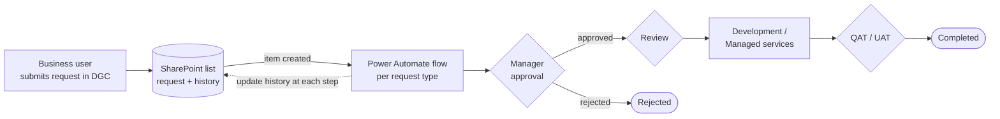
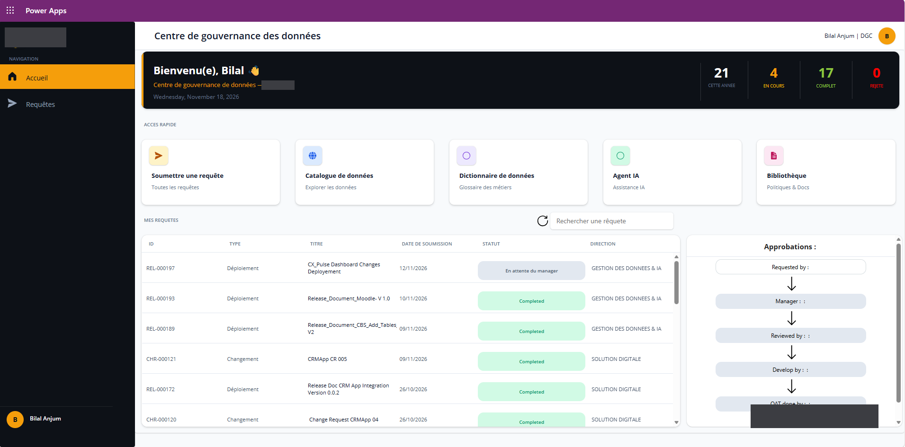
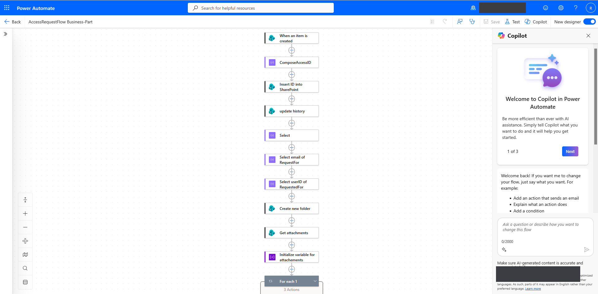
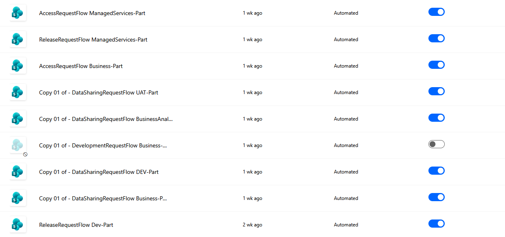

# Data Governance Command Center (DGC)

> A central **Power Apps** portal, backed by **Power Automate** workflows and **SharePoint**, where business users submit and track data-access, data-sharing, development, change and release requests. Each request moves through a defined approval chain with full history, and teams get one place to see every request and its status.

`Power Apps` · `Power Automate` · `SharePoint` · `Microsoft 365` · `Approval workflows` · `Data governance`

---

## Overview

**DGC** stands for **Data Governance Center** (*Centre de gouvernance des données*). Before it existed, requests for data access, data sharing and changes to data products arrived by email and chat, with no consistent approvals and no single view of status.

The DGC app gives the bank's data and AI governance function a **front door**: business users submit a request once, the right people approve it in the right order, and everyone can see where it stands.

## Problem and goals

**Problem**
- Data-access and change requests were spread across email threads.
- Approvals (manager, review, development, testing) were inconsistent and hard to evidence.
- No central view of open requests, their stage or their history.

**Goals**
- A single, user-friendly entry point for governance requests.
- A standard, multi-stage approval workflow for each request type.
- Automatic audit history for every request.
- Quick access to governance resources (catalog, glossary, policies).

## Key features

| Feature | Description |
|---|---|
| **Home dashboard** | Personal welcome and counters for requests this year, in progress, completed and rejected |
| **Submit a request** | One form for all request types |
| **My requests** | Searchable list with ID, type, title, submission date, status and requesting department |
| **Request types** | Data access, data sharing, development, change (`CHR-…`) and release/deployment (`REL-…`) |
| **Approval tracker** | Visual chain: Requested by → Manager → Reviewed by → Developed by → QAT done by → … |
| **Data catalog** | Entry point to explore available data |
| **Data dictionary** | Business glossary of terms |
| **AI agent** | AI assistance from inside the app |
| **Library** | Governance policies and documents |

## Workflow

Each request type has its own **automated Power Automate flows**, split by the team that handles that stage. For example:
- `AccessRequestFlow` with *Business* and *Managed Services* parts
- `DataSharingRequestFlow` with *Business*, *Business Analyst*, *DEV* and *UAT* parts
- `ReleaseRequestFlow` with *Dev* and *Managed Services* parts
- `DevelopmentRequestFlow` with a *Business* part

A typical flow (access request, business part) is triggered **when a SharePoint item is created**. It generates a request ID, writes the ID back to SharePoint, **updates the request history**, resolves the requester and the "requested for" user (email and user ID), creates a document folder for the request, and processes the attachments.

## Architecture

| Layer | Technology | Purpose |
|---|---|---|
| User interface | Power Apps (canvas app, French UI) | Submission, tracking, dashboard, quick access |
| Workflow | Power Automate (automated cloud flows) | Routing, approvals, ID generation, notifications |
| Data and documents | SharePoint lists and libraries | Requests, history, attachments |
| Identity | Microsoft Entra ID / Microsoft 365 | User resolution and approvals |

## Business value

- **One front door:** every governance request is in one place, with no lost emails.
- **Faster turnaround:** automated routing removes manual hand-offs between teams.
- **Audit-ready:** every step is recorded in the request history.
- **Visibility:** requesters and governance teams see live status and workload.

## Screenshots

| DGC home | Access request flow |
|---|---|
|  |  |
| Home: counters, quick access, my requests and the approval chain | Power Automate flow triggered on a new SharePoint request |

| Automated flows |
|---|
|  |
| Request flows split by request type and team |

## Security and privacy

- Users act under their own Microsoft 365 identity, and approvals are tied to named roles.
- Attachments are stored in per-request SharePoint folders.
- Organization name and logo are removed. Request titles in the screenshot are internal project names.

## My role

I designed and built the DGC app and its workflows: the Power Apps interface, the SharePoint data model, and the Power Automate flows for each request type and approval stage.

---
Organization branding and environment names have been removed.
